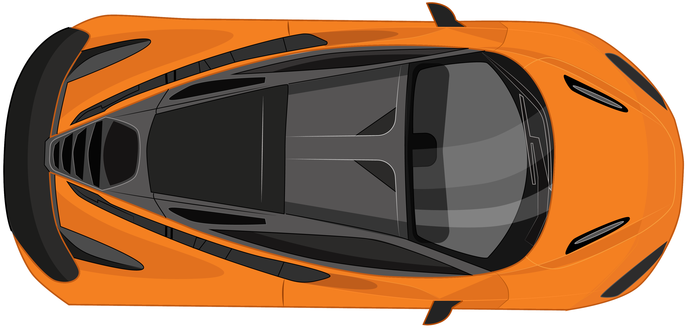

# ITZFIZZ — Scroll-Driven Hero Animation

A production-ready, scroll-driven interactive hero animation inspired by the [Paras Chaturvedi Car Scroll Animation](https://paraschaturvedi.github.io/car-scroll-animation/), built with **React 19**, **Vite**, **Tailwind CSS v4**, and **GSAP ScrollTrigger**.



---

## ⚡ Key Highlights & Features

- **True Scroll-Driven Dynamics**: The orange McLaren 720S sports car moves along the track pinned to the scrollbar via GSAP ScrollTrigger with scrubbed timeline interpolation.
- **Dynamic Green Speed Trail**: A vibrant `#45db7d` trail expands continuously behind the car as it accelerates across the road.
- **Letter-by-Letter Reveal**: The bold `WELCOME ITZFIZZ` banner emerges character-by-character as the vehicle's bumper crosses each letter's X-coordinate.
- **Staggered Statistical Impact Cards**:
  - 🟨 **58%** — Increase in pick-up point use (`#def54f`)
  - 🟦 **23%** — Decreased customer phone calls (`#6ac9ff`)
  - ⬛ **27%** — Secondary hub efficiency gain (`#333333`)
  - 🟧 **40%** — Decreased inbound inquiries (`#fa7328`)
- **Natural Bi-directional Scrubbing**: Scrolling backwards reverses every animation phase seamlessly without glitching or desync.
- **Full Responsive Adaptation**: Meticulously designed for Desktop (1440px+), Laptop (1024px–1439px), Tablet (768px–1023px), and Mobile (320px–767px).
- **Graceful Fallbacks & Accessibility**:
  - Automatic base path resolution for GitHub Pages or local development.
  - Built-in SVG vector fallback in case PNG car visual assets are unavailable.
  - Full support for `prefers-reduced-motion` media queries.
  - Web Audio API engine sound synthesis (zero external audio file dependencies).

---

## 🛠️ Technology Stack

| Layer | Technology |
|---|---|
| **Framework** | React 19 (Functional Components & Hooks) |
| **Build Tool** | Vite 6 |
| **Animation Engine** | GSAP 3.12 (`ScrollTrigger`, `@gsap/react`, `useGSAP`) |
| **Styling** | Tailwind CSS v4 (`@tailwindcss/vite`) + Custom CSS Tokens |
| **Deployment** | GitHub Actions & GitHub Pages |

---

## 📂 Project Directory Structure

```text
itz-fizz-scroll-hero/
├── .github/
│   └── workflows/
│       └── deploy.yml          # GitHub Pages CI/CD workflow
├── public/
│   └── images/
│       ├── car.png             # McLaren 720S high-res transparent asset
│       └── McLaren 720S 2022 top view.png
├── src/
│   ├── components/
│   │   ├── Navbar.jsx          # Top bar with sound toggle & live badge
│   │   ├── Hero.jsx            # Core scroll-driven track & car animation
│   │   ├── Statistics.jsx      # The 4 reference impact metric boxes
│   │   ├── VehicleVisual.jsx   # Top-view vehicle with SVG fallback
│   │   ├── FeaturesSection.jsx # Control dock & tech specifications
│   │   └── Footer.jsx          # Footer & scroll-to-top handler
│   ├── App.jsx                 # Application layout shell
│   ├── main.jsx                # React 19 bootstrap
│   └── index.css               # Tailwind v4 import & animation tokens
├── index.html                  # HTML entry point with modern typography & SEO
├── package.json                # Project dependencies & scripts
├── vite.config.js              # Vite configuration with GitHub Pages base path
└── README.md
```

> **IMPORTANT: Folder Root Verification**  
> Ensure your IDE (VS Code or Antigravity) is opened directly inside `itz-fizz-scroll-hero` where `package.json`, `index.html`, and `vite.config.js` reside at the top level. Running `npm` from parent or nested folders will cause `ENOENT` errors.

---

## 🚀 Local Development Setup

### 1. Prerequisites
- Node.js `v18.0.0` or higher
- npm `v9.0.0` or higher

### 2. Installation
Clone the repository and install dependencies from the project root:

```bash
cd itz-fizz-scroll-hero
npm install
```

### 3. Start Development Server
```bash
npm run dev
```
Open [http://localhost:5173](http://localhost:5173) in your browser.

### 4. Build for Production
```bash
npm run build
```
The optimized production bundle will be generated in `dist/`.

To preview the production build locally:
```bash
npm run preview
```

---

## 🌐 GitHub Pages Deployment Guide

### Step 1: Set the Vite Base Path
In `vite.config.js`, configure your repository name:
- For repository `https://github.com/USERNAME/itz-fizz-scroll-hero/`:
  ```javascript
  const base = process.env.BASE_PATH || (process.env.NODE_ENV === 'production' ? '/itz-fizz-scroll-hero/' : '/')
  ```
- If deploying to a user site (`https://USERNAME.github.io/`), change `base` to `'/'`.

### Step 2: Push to GitHub
```bash
git add .
git commit -m "feat: complete ITZFIZZ scroll-driven hero implementation"
git branch -M main
git remote add origin https://github.com/YOUR_USERNAME/itz-fizz-scroll-hero.git
git push -u origin main
```

### Step 3: Enable GitHub Pages in Repository Settings
1. Go to your repository on GitHub.
2. Click **Settings** > **Pages** (under the "Code and automation" section).
3. Under **Build and deployment > Source**, select **GitHub Actions**.

### Step 4: Verify Deployment
1. Go to the **Actions** tab on your GitHub repository.
2. The `Deploy ITZFIZZ to GitHub Pages` workflow will automatically run on every push to `main`.
3. Once the workflow turns green, click the deployment URL (e.g. `https://YOUR_USERNAME.github.io/itz-fizz-scroll-hero/`).

---

## 🏎️ GSAP Animation Implementation Architecture

1. **ScrollTrigger Pinning**: The stage (`.track-viewport`) is pinned to the viewport using:
   ```javascript
   scrollTrigger: {
     trigger: containerRef.current,
     start: 'top top',
     end: 'bottom bottom',
     scrub: 0.65,
     pin: trackRef.current,
     anticipatePin: 1,
     invalidateOnRefresh: true,
   }
   ```
2. **Sub-pixel Scrubbing**: All vehicle coordinates are governed by CSS transforms (`x`), avoiding expensive repaints or layout recalcs.
3. **Dynamic Letter Hit-Testing**: During the `onUpdate` scroll tick, the car's leading edge `carFrontX` is compared against each letter's calculated offset, revealing letters cleanly without jitter.
4. **React 19 Cleanups**: Built with `@gsap/react` (`useGSAP`), ensuring timeline and ScrollTrigger instances are properly garbage collected on hot-reloading or unmounting.

---

## 📄 License
MIT License. Inspired by [Paras Chaturvedi](https://paraschaturvedi.github.io/car-scroll-animation/).
